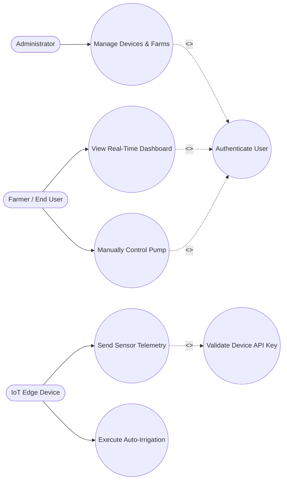

# Smart Irrigation Management System (SIMS)
## Comprehensive Final Project Documentation & Technical Report

---
> **Instructions for Adding Screenshots:** 
> Create a `screenshots` folder in the same directory as this file. Save your images there, and update the filenames in the brackets below (e.g., change `[./screenshots/dashboard.png]` to your actual file name).
---

## Table of Contents
1. [Abstract](#1-abstract)
2. [Introduction & Objectives](#2-introduction--objectives)
3. [Detailed System Requirements](#3-detailed-system-requirements)
4. [System Architecture & Roles](#4-system-architecture--roles)
5. [Hardware Implementation Details](#5-hardware-implementation-details)
6. [Software Implementation Details](#6-software-implementation-details)
7. [User Interface (Screenshots)](#7-user-interface)
8. [Conclusion](#8-conclusion)

---

## 1. Abstract
The Smart Irrigation Management System (SIMS) is a comprehensive, Internet of Things (IoT) based agricultural solution engineered to solve the persistent challenges of water waste and manual farm management. By deploying edge-computing microcontrollers paired with environmental sensors, the system continuously tracks real-time data including soil volumetric water content, ambient temperature, humidity, and water reservoir levels. 

Rather than relying on human guesswork or rigid timer-based schedules, SIMS intelligently determines precise watering needs dynamically. This expanded technical report details the complete hardware-software ecosystem: the sensory Perception Layer utilizing ESP32/ESP8266 microcontrollers, the Network Processing Layer driven by a Node.js REST API and MongoDB, and the Application Layer featuring a secure, bilingual React.js dashboard. Together, these layers form a cohesive platform that enhances crop yield, prevents hardware damage, and conserves vital water resources.

---

## 2. Introduction & Objectives

### 2.1 The Problem Statement
Traditional irrigation methods rely heavily on manual labor or static scheduling timers. This approach has critical flaws: during wet periods, timers continue to run, leading to significant water waste and root rot. Conversely, during sudden dry spells, plants suffer from under-watering until a human intervenes. Furthermore, farm managers lack a centralized system to view historical soil health or receive alerts if a water tank runs empty, which frequently results in expensive water pumps running dry and burning out.

### 2.2 Core Objectives
To solve these challenges, the AgriSmart system was developed with the following expanded objectives:
*   **Precision Water Optimization:** To eliminate water waste by triggering water pumps *only* when soil moisture falls below a strict, designated threshold (e.g., 30%), ensuring plants get water exactly when needed.
*   **Centralized Remote Monitoring:** To provide a real-time web dashboard that visualizes live sensor data, allowing farmers to monitor vast agricultural areas from a single screen and manually override actuators from anywhere in the world.
*   **Hardware Resiliency & Protection:** To implement intelligent "fallback logic" at the edge level. If the system detects an empty water tank, it must instantly disable the pump—even if the soil is dry—to prevent mechanical burnout (Dry-Run Protection).
*   **Cross-Cultural Accessibility:** To deliver a seamlessly bilingual user interface, allowing users to toggle between English and Amharic (አማርኛ) instantly, ensuring the technology is accessible to local agricultural workers.

---

## 3. Detailed System Requirements

To ensure a robust build, the system strictly adheres to the following functional and non-functional requirements.

### 3.1 Functional Requirements
*   **FR1 (Continuous Sensing):** The edge IoT device must persistently measure soil moisture, temperature, humidity, and tank water levels at predefined intervals.
*   **FR2 (Automated Logic):** The backend must evaluate rules every 5 minutes. It must automatically issue a `PUMP_ON` command if moisture drops below the threshold AND the tank has water.
*   **FR3 (Dry-Run Protection):** The hardware must physically disable the pump and sound a local buzzer alarm if the float sensor reads `LOW` (empty tank), ignoring all other irrigation commands to protect the motor.
*   **FR4 (Secure Ingestion):** The backend must strictly authenticate all incoming telemetry using MAC addresses and a secure `X-Device-Api-Key`. Unauthorized data must be rejected.
*   **FR5 (Manual Override):** The system must provide authenticated users the ability to manually toggle the water pump and buzzer ON or OFF via the web dashboard.
*   **FR6 (Real-Time Broadcasting):** The backend must push telemetry updates to connected clients immediately using WebSockets, avoiding the need for the user to manually refresh the browser.

### 3.2 Non-Functional Requirements
*   **Usability (Localization):** The web interface must utilize an internal context state to swap between English and Amharic text dynamically without network delays.
*   **Reliability (Edge Fallback):** The ESP microcontrollers must possess localized fallback logic. If the Wi-Fi connection to the server drops, the hardware must still be able to execute basic auto-irrigation locally to keep crops alive.
*   **Performance (Telemetry Timing):** To balance real-time tracking with network bandwidth, the IoT device must transmit a lightweight heartbeat ping every 12 seconds, and a heavier, full sensor payload every 30 seconds.
*   **Security (JWT Authentication):** All user sessions must be secured via JSON Web Tokens (JWT) with bcrypt password hashing, ensuring that unauthorized users cannot trigger the water pumps.

---

## 4. System Architecture & Roles

The SIMS architecture is fundamentally divided into three distinct, decoupled layers, ensuring scalability and easy maintenance.

### 4.1 The Three-Layer Architecture
1.  **The Perception Layer (IoT/Hardware):** This is the physical layer sitting in the farm. It gathers raw analog and digital data from the soil and air, converting it into digital JSON payloads.
2.  **The Network & Processing Layer (Backend):** This is the "brain" of the system hosted on a server. It receives the JSON payloads via Wi-Fi/Ethernet, saves the data to the database, evaluates the automation rules, and securely routes commands back to the hardware.
3.  **The Application Layer (Frontend):** This is the visual interface. It consumes the backend APIs to draw charts, buttons, and gauges for the human users.

### 4.2 System Roles (Actors)
The system ensures security by strictly separating what different users can do.
*   **Administrator:** The highest-level role. They oversee the entire platform, register new hardware devices into the database, and approve or suspend user accounts.
*   **Farmer (End User):** The primary operator. They log into the dashboard to view real-time crop conditions, manually control the pump and buzzer, and view historical sensor charts.
*   **IoT Edge Device (Hardware Actor):** The physical microcontrollers. This non-human actor acts independently to read sensors, protect the pump, and publish data.
*   **Backend System (Server Role):** The automated coordinator. It constantly listens for device heartbeats, stores historical data in MongoDB, and broadcasts Socket.IO updates.

### 4.3 Use Case Diagram
The following Use Case Diagram maps the exact relationships between these actors and the system processes. The `<<include>>` arrows highlight mandatory dependencies (e.g., you cannot view the dashboard without authenticating).

---

## 5. Hardware Implementation Details

This section breaks down the specific physical components chosen for the project and why they were selected.

### 5.1 Microcontrollers
*   **ESP8266 (NodeMCU):** Selected for its built-in 2.4GHz Wi-Fi capabilities, low cost, and sufficient GPIO pins. It acts as the primary wireless brain of the sensor nodes.
*   **ESP32 (WT32-ETH01):** Utilized for environments where Wi-Fi is unstable. It provides a highly stable, wired RJ45 Ethernet connection and has more memory for local offline data buffering.

### 5.2 Sensors and Actuators Explained
*   **Capacitive Soil Moisture Sensor:** Unlike cheap resistive sensors that corrode quickly in wet soil, this uses capacitance to measure the dielectric permittivity of the soil, ensuring a much longer lifespan and more accurate Volumetric Water Content (VWC) readings.
*   **DHT11 / DHT22 Sensor:** A digital sensor that measures ambient air temperature and humidity, crucial for determining if water is evaporating too quickly from the soil.
*   **Float Level Switch:** A magnetic reed switch that sits inside the water tank. When the water level drops too low, the magnet falls, breaking the circuit (reads `LOW`), instantly triggering the dry-run protection.
*   **pH Sensor:** Measures the acidity or alkalinity of the water/soil, helping farmers ensure the soil remains optimal for nutrient absorption.
*   **12V Water Pump & Relay:** The ESP8266 outputs 3.3V, which cannot drive a 12V pump. A relay module is used as a bridge. It is "Active-LOW", meaning the microcontroller must send a `0V (LOW)` signal to turn the pump `ON`.
*   **Alarm Buzzer:** Provides a loud, localized audible alert in the field to notify nearby workers of hardware faults.

### 5.3 ESP8266 Exact Wiring Reference
The following table provides the exact pin mapping required to replicate the hardware setup:

| NodeMCU Pin | Component Connection | Technical Purpose |
| :--- | :--- | :--- |
| **A0** | Soil Moisture Sensor | Reads analog voltage (0-1024) to calculate moisture %. |
| **D1 (GPIO 5)** | Water Level Float Sensor | Reads digital High/Low for tank capacity. |
| **D2 (GPIO 4)** | pH Sensor | Reads analog values via an ADC conversion circuit. |
| **D3 (GPIO 0)** | Water Pump Relay | Digital output pin. Active-LOW to trigger the pump. |
| **D4 (GPIO 2)** | Alarm Buzzer | Digital output to trigger sound. |
| **D5 (GPIO 14)** | DHT11 / DHT22 Data Pin | Uses a specific one-wire protocol to read temp/humidity. |
| **3.3V / GND** | Sensor VCC / GND | Powers the low-voltage sensors. |
| **VIN / GND** | Relay VCC (5V) / GND | Powers the relay module via the 5V USB input. |

---

## 6. Software Implementation Details

The software is built on the modern MERN stack (MongoDB, Express, React, Node.js), optimized for IoT data processing.

### 6.1 Backend Infrastructure (Node.js & Express)
*   **Asynchronous Processing:** Node.js was chosen because its event-driven, non-blocking I/O model is perfect for handling hundreds of simultaneous HTTP requests from various IoT devices without slowing down.
*   **Real-Time Engine (Socket.IO):** Traditional HTTP requires the browser to constantly "ask" the server if there is new data. Socket.IO keeps a bidirectional tunnel open, allowing the server to instantly push sensor updates to the React dashboard the millisecond they arrive from the ESP8266.
*   **Device Status Service (Cron Job):** A background script runs continuously. If a device has not sent a heartbeat ping in over 30 seconds, the backend automatically flags the device as `OFFLINE` and grays out the dashboard controls to prevent users from sending commands to a dead device.

### 6.2 Database (MongoDB)
MongoDB, a NoSQL database, was selected because IoT telemetry data is inherently formatted as JSON documents. 
*   **Users Collection:** Stores encrypted passwords and role permissions.
*   **Devices Collection:** Maps specific MAC addresses to specific farms, storing secure API keys.
*   **Telemetry Collection:** A highly scalable time-series collection storing every sensor reading, allowing the system to generate historical charts for the farmer.

### 6.3 Frontend (React.js & Vite)
*   **Component-Based UI:** The dashboard is built using React components, ensuring that when new sensor data arrives, only the specific gauge or chart updates, rather than reloading the entire page.
*   **Global Language Context:** Utilizing `react-i18next`, the entire application is wrapped in a language state. When the user clicks the "Amharic" button, all text elements on the screen instantly swap languages by pulling from a localized JSON dictionary.

---

## 7. User Interface

The following screenshots demonstrate the practical application of the software and hardware integration. 
*(Please insert your project screenshots in the placeholders below)*

**7.1 System Architecture & Physical Hardware Setup**
*This image showcases the physical wiring of the ESP8266, relay, pump, and sensors.*

**7.2 Main Real-Time Dashboard View**
*This interface displays the live sensor gauges, historical charts, and device online/offline status.*

**7.3 Manual Controls and Alert Notifications**
*This view highlights the toggle switches used to manually override the pump and buzzer, alongside critical system alerts.*

**7.4 Multilingual (Amharic) Dashboard**
*This screenshot demonstrates the seamless translation of the user interface into Amharic for local accessibility.*

---

## 8. Conclusion
The Smart Irrigation Management System (SIMS) represents a significant leap forward in agricultural technology, effectively bridging robust IoT edge hardware with modern, full-stack web architectures. By fully automating water delivery based on real-time empirical data rather than manual observation, the system vastly conserves vital water resources, reduces human labor costs, and maximizes crop health. 

Crucially, the system's strict architectural design ensures that it is fault-tolerant. Through localized dry-run protection and offline fallback logic, the hardware protects itself even when network infrastructure fails. The integration of a real-time, bilingual web dashboard ensures that this advanced technology remains fully accessible and highly practical for end-users, farm owners, and system administrators alike.

---
**End of Expanded Final Documentation**
