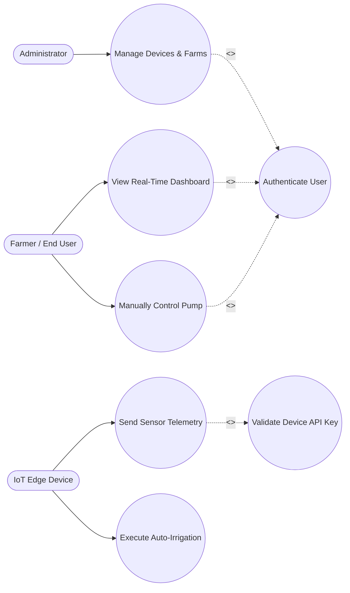

# Smart Irrigation Management System (SIMS)
## Formal Technical Documentation & Project Report

---

> **Note on Adding Screenshots:** 
> Throughout this document, you will see placeholder tags for screenshots formatted like this: ``. 
> To add your actual screenshots:
> 1. Create a folder named `screenshots` in the same directory as this file.
> 2. Save your image files in that folder.
> 3. Update the filenames in the brackets (e.g., change `dashboard.png` to your actual file name).

---

## Table of Contents
1. [Abstract](#1-abstract)
2. [Introduction](#2-introduction)
3. [System Architecture & Workflow](#3-system-architecture--workflow)
4. [Hardware Implementation](#4-hardware-implementation)
5. [Software Implementation](#5-software-implementation)
6. [User Interface & Operation](#6-user-interface--operation)
7. [Conclusion](#7-conclusion)

---

## 1. Abstract
The Smart Irrigation Management System (SIMS) is an automated, Internet of Things (IoT) based agricultural solution designed to optimize water consumption and enhance crop yield. By leveraging real-time environmental data—such as soil moisture, temperature, humidity, and pH levels—the system intelligently determines the precise watering needs of the soil. This report details the hardware and software architecture, including the integration of ESP32/ESP8266 microcontrollers, a Node.js REST API, and a React-based web dashboard.

## 2. Introduction

### 2.1 Background
Traditional irrigation methods often rely on manual labor or static timers, leading to significant water waste and potential crop damage due to over- or under-watering. With the advent of IoT, it is now possible to continuously monitor soil conditions and automate the irrigation process dynamically.

### 2.2 Objectives
*   **Water Optimization:** Trigger water pumps only when soil moisture falls below critical thresholds.
*   **Remote Monitoring & Control:** Provide farm managers with a centralized web dashboard to monitor environmental conditions and control actuators remotely.
*   **System Resiliency:** Ensure local fallback mechanisms are in place to prevent dry-running pumps and maintain irrigation schedules even during network outages.
*   **Accessibility:** Deliver a bilingual user interface (English and Amharic) for broader usability.

---

## 3. System Architecture & Workflow

The SIMS architecture is fundamentally divided into three distinct layers: the **Perception Layer** (Hardware/IoT), the **Network & Processing Layer** (Backend Server), and the **Application Layer** (Frontend UI).

*(Please insert your system block diagram or architecture flowchart below)*

### 3.1 Overview of Layers
*   **Perception Layer:** Consists of ESP microcontrollers connected to environmental sensors (DHT11/22, Soil Moisture, pH) and actuators (Relay, Water Pump, Buzzer).
*   **Network Layer:** Employs Wi-Fi/Ethernet to transmit JSON payloads via HTTP/WebSockets to the central server.
*   **Application Layer:** A React dashboard visualizing the telemetry data stored in a MongoDB database.

### 3.2 Roles and Workflow
The system operates through the interaction of four distinct roles, ensuring secure and automated data flow:

1.  **Administrator:** The system manager who oversees the entire platform. They register new farms, authorize incoming IoT edge devices by their MAC addresses, and manage user accounts. 
2.  **Farmer (End User):** The primary human operator. The farmer logs into the dashboard to view real-time environmental conditions, manually overrides actuators (like turning the pump ON/OFF remotely), and receives critical alerts such as low tank water levels.
3.  **IoT Edge Device (Hardware Actor):** The physical microcontrollers (ESP32/ESP8266) deployed in the field. This role constantly reads sensor data, executes vital local fallback logic (such as auto-irrigating when soil is dry), and securely publishes telemetry to the backend.
4.  **Backend System (Server Role):** The central coordinator. It receives incoming telemetry, checks device heartbeats, stores historical data in MongoDB, validates API keys, and broadcasts real-time WebSocket events to active users.

### 3.3 Use Case Diagram
The following Use Case Diagram illustrates the interactions between the actors and the system. Mandatory processes are linked using `<<include>>` to denote that a primary action *must* execute the included action to succeed.

*(You can replace the mermaid code above with a screenshot of a UML diagram if preferred: ``)*

---

## 4. Hardware Implementation

This section details the physical components deployed in the field.

*(Please insert a photo of your physical hardware setup or circuit wiring below)*

### 4.1 Microcontrollers
The system utilizes robust edge devices to read sensors and execute logic:
*   **ESP8266 (NodeMCU):** Serves as the primary wireless IoT node communicating over 2.4GHz Wi-Fi.
*   **ESP32 (WT32-ETH01):** Utilized for highly stable, wired Ethernet connections, offering local storage buffering (SPIFFS) when offline.

### 4.2 Sensors and Actuators
*   **Capacitive Soil Moisture Sensor:** Measures the volumetric water content (VWC) of the soil, triggering the automated irrigation logic.
*   **DHT11 / DHT22 Sensor:** Tracks ambient environmental temperature and humidity.
*   **Float Level Switch:** Monitors the water reservoir. If the water level is `LOW`, it triggers dry-run protection.
*   **pH Sensor:** Measures water/soil alkalinity to ensure optimal nutrient absorption.
*   **12V Water Pump & Relay:** An active-LOW relay module that drives the DC water pump.
*   **Alarm Buzzer:** Provides a localized audible alert if a fault (e.g., empty water tank) is detected.

---

## 5. Software Implementation

The software ecosystem handles data ingestion, real-time analytics, user authentication, and system commands.

### 5.1 Backend Infrastructure (Node.js & Express)
*   **RESTful API:** Manages user authentication (JWT), device registration, and manual irrigation overrides.
*   **Real-Time Engine:** Utilizes `Socket.IO` to instantly broadcast telemetry updates to connected frontend clients without requiring page refreshes.
*   **Device Status Service:** A background cron job checks for device "heartbeats" every 10 seconds. If a node is unresponsive for over 30 seconds, it is marked as `OFFLINE`.

### 5.2 Database (MongoDB)
Data is securely stored using a NoSQL schema layout:
*   `Users`: Encrypted credentials and language preferences.
*   `Farms & Devices`: MAC addresses, API keys, and spatial grouping.
*   `Telemetry`: Historical time-series data of sensor readings for future analytics.

---

## 6. User Interface & Operation

The frontend is built using **React.js** and **Vite**, offering a seamless, responsive experience across desktop and mobile devices.

### 6.1 Real-Time Dashboard
The central dashboard provides live gauges and charts for moisture, temperature, humidity, and tank levels.

*(Please insert a screenshot of your main web dashboard below)*

### 6.2 Manual Controls and Alerts
Users have the ability to manually override the automated system. The dashboard includes intuitive toggle switches for the Water Pump and the Alarm Buzzer.

*(Please insert a screenshot showing the manual controls or an alert notification below)*

### 6.3 Multilingual Support
To cater to local farmers, the UI includes a global context state that toggles the entire application language between **English** and **Amharic (አማርኛ)** seamlessly.

*(Please insert a screenshot showing the Amharic translation of the UI below)*

---

## 7. Conclusion
The Smart Irrigation Management System effectively bridges modern IoT capabilities with traditional agriculture. By automating water delivery based strictly on real-time empirical data, the system conserves vital water resources, reduces human labor, and minimizes the risk of hardware failure through intelligent offline fallbacks and dry-run protection. 

---
**End of Document**
