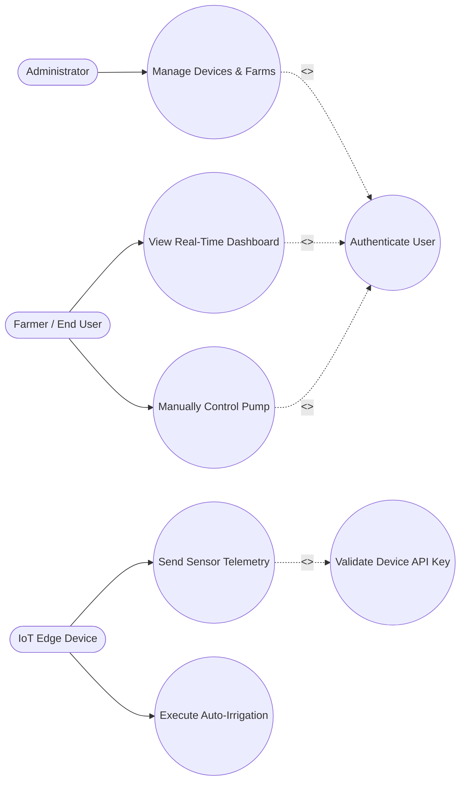

# Requirements Analysis Document (RAD)
## Smart Irrigation Management System (SIMS)

---

> **Note on Adding Screenshots:** 
> In Section 3.4.5 (User Interface), you will see placeholder tags for your screenshots formatted like ``. 
> 1. Create a `screenshots` folder in this directory.
> 2. Save your images there.
> 3. Update the filenames in the brackets.

---

## 1. Introduction

### 1.1 Purpose of the System
The purpose of the Smart Irrigation Management System (SIMS) is to provide an automated, Internet of Things (IoT) based agricultural solution that optimizes water consumption and enhances crop yield. It intelligently determines precise watering needs using real-time environmental data.

### 1.2 Scope of the System
The system encompasses edge hardware (ESP32/ESP8266 microcontrollers and environmental sensors), a Node.js/Express backend server, and a React-based frontend web dashboard. It is designed for farms and gardens requiring remote monitoring, automated irrigation, and localized hardware fallbacks during network loss.

### 1.3 Objectives and Success Criteria
*   **Water Optimization:** Trigger water pumps only when soil moisture falls below 30%.
*   **Remote Monitoring:** Provide a centralized dashboard for real-time sensor visualization.
*   **System Resiliency:** Prevent dry-running pumps and maintain irrigation via offline fallback logic.
*   **Accessibility:** Deliver a bilingual user interface (English and Amharic).

### 1.4 Definitions, Acronyms, and Abbreviations
*   **SIMS:** Smart Irrigation Management System
*   **IoT:** Internet of Things
*   **VWC:** Volumetric Water Content
*   **JWT:** JSON Web Token
*   **ESP:** Espressif Systems Microcontroller (ESP32/ESP8266)

### 1.5 Overview
The remainder of this document describes the current manual irrigation systems, followed by the proposed SIMS system. The proposed system is detailed through its functional and non-functional requirements, followed by system models including use cases and user interfaces.

---

## 2. Current System
Traditional irrigation methods rely on manual labor or static scheduling timers. This leads to significant water waste during rainy periods and potential crop damage due to under-watering in dry conditions. Furthermore, farm managers lack real-time visibility into soil health and water tank levels, requiring constant physical presence to prevent equipment damage (e.g., pumps running dry).

---

## 3. Proposed System

### 3.1 Overview
The proposed SIMS automates water delivery based strictly on real-time empirical data. It bridges IoT capabilities with agriculture by utilizing hardware perception layers, network processing, and a frontend application layer for user interaction.

### 3.2 Functional Requirements
*   **FR1:** The IoT device must continuously measure soil moisture, temperature, humidity, and tank water levels.
*   **FR2:** The system must automatically trigger the water pump relay if soil moisture drops below the defined threshold AND the water tank is not empty.
*   **FR3:** The hardware must sound a local buzzer alarm and disable the pump if the water tank is empty (Dry-Run Protection).
*   **FR4:** The backend must authenticate users and validate IoT devices using MAC addresses and API keys.
*   **FR5:** The system must allow users to manually override and toggle the water pump and buzzer via the web dashboard.
*   **FR6:** The system must broadcast real-time telemetry updates to connected clients using WebSockets.

### 3.3 Non-Functional Requirements
#### 3.3.1 Usability
*   The web interface must support seamless toggling between English and Amharic (አማርኛ) translations.
#### 3.3.2 Reliability
*   The hardware must possess offline buffering and local fallback logic to execute auto-irrigation even if the Wi-Fi/Ethernet connection drops.
#### 3.3.3 Performance
*   The IoT device must transmit a heartbeat ping every 12 seconds and a full sensor payload every 30 seconds.
*   The backend must mark a device as `OFFLINE` if no heartbeat is received for 30 consecutive seconds.
#### 3.3.4 Security
*   All user sessions must be secured via JWT. IoT device telemetry must include a secure `X-Device-Api-Key` header.

---

### 3.4 System Models

#### 3.4.1 Scenarios
*   **Scenario 1 (Automated Watering):** The soil moisture sensor detects 25% moisture. The device checks the float sensor, confirms the tank has water, and pulls the relay LOW to turn on the pump. Once moisture reaches 60%, the pump turns off.
*   **Scenario 2 (Empty Tank Alert):** The tank float sensor reads LOW. The device instantly shuts off the pump, activates the local buzzer, and sends an alert payload to the dashboard notifying the farmer.

#### 3.4.2 Use Case Model
The system operates through the interaction of four distinct roles. Mandatory processes are linked using `<<include>>` to denote that a primary action *must* execute the included action to succeed.

**Four System Roles (Actors):**
1.  **Administrator:** Manages the system. Registers new farms, authorizes incoming IoT edge devices by their MAC addresses, and manages user accounts. 
2.  **Farmer (End User):** The primary human operator. Logs into the dashboard to view real-time conditions, manually controls actuators, and receives critical alerts.
3.  **IoT Edge Device (Hardware Actor):** The physical microcontrollers (ESP32/ESP8266). Reads sensor data, executes local fallback logic, and publishes telemetry.
4.  **Backend System (Server Role):** The central coordinator. Tracks device heartbeats, stores data in MongoDB, validates API keys, and broadcasts WebSocket updates.

**Use Case Diagram:**

#### 3.4.3 Object Model
*   **Microcontrollers:** ESP8266 (Wi-Fi) and ESP32 (Ethernet/SPIFFS).
*   **Sensors:** Capacitive Soil Moisture, DHT11/22, Float Level Switch, pH Sensor.
*   **Actuators:** 12V Water Pump Relay (Active-LOW), Alarm Buzzer.
*   **Database Schema:** Collections for `Users`, `Farms`, `Devices`, and `Telemetry`.

#### 3.4.4 Dynamic Model
*   **Connection State Machine:** 
    *   `ONLINE`: Heartbeat received within the last 30 seconds.
    *   `OFFLINE`: No data for >30 seconds. Dashboard gauges display `--` and controls are disabled.

#### 3.4.5 User Interface (Screenshots)
*(Please insert your project screenshots in the placeholders below)*

**1. System Architecture / Hardware Setup**

**2. Main Dashboard View**

**3. Manual Controls and Alerts**

**4. Multilingual (Amharic) Dashboard**

---
**End of RAD Document**
